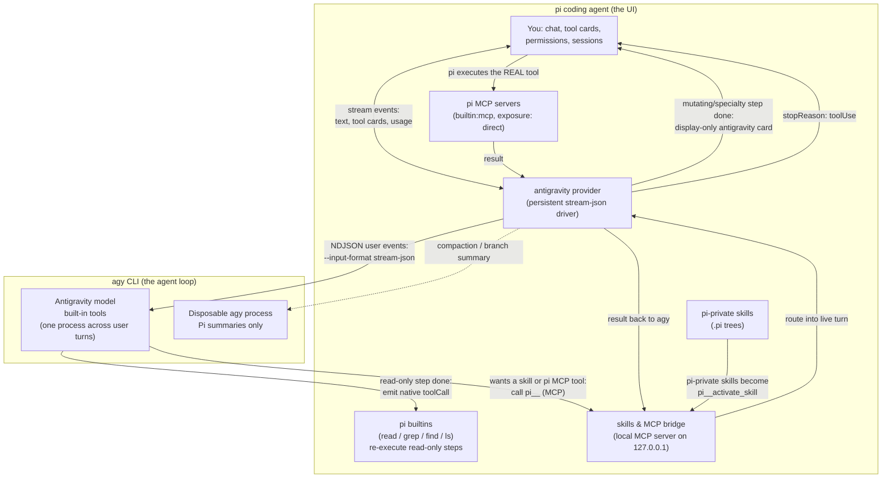

# pi-agy

Use **Google Antigravity** (`agy`) models inside the [pi coding agent](https://pi.dev). pi stays your UI — chat, model picker, tool cards, sessions — while the selected Antigravity model runs underneath through the `agy` CLI.

## Contents

- [Installation](#installation)
- [Highlights](#highlights)
- [Commands](#commands)
- [Features](#features)
  - [Consult another model (`/m`)](#consult-another-model-m)
  - [Boost mode (`/boost`)](#boost-mode-boost)
  - [Teamwork mode (`/teamwork`)](#teamwork-mode-teamwork)
  - [Side conversations (`/btw`)](#side-conversations-btw)
  - [Pi tools mode (`/agy-tools`)](#pi-tools-mode-agy-tools)
  - [Private MCP discovery](#private-mcp-discovery)
  - [MCP adapter migration](#mcp-adapter-migration)
  - [Background tasks (`/agy-tasks`)](#background-tasks-agy-tasks)
  - [Artifacts and subagents](#artifacts-and-subagents)
  - [Model quotas (`/agy-usage`)](#model-quotas-agy-usage)
- [Context and permissions](#context-and-permissions)
- [Configuration flags](#configuration-flags)
- [Terms of Service & account safety](#terms-of-service--account-safety)
- [How it works](#how-it-works)
- [Release notes](#release-notes)

## Installation

```bash
pi install git:github.com/teededung/pi-agy
```

To update later on any machine:

```bash
pi update git:github.com/teededung/pi-agy
```

## Highlights

| Feature | What you get |
| --- | --- |
| **Persistent stream driver** | Ordinary user turns reuse one healthy `agy` process. Conversation, model, workspace, agent, mode, and bridge changes recycle it safely. |
| **One-shot consult** (`/m`) | Ask another Antigravity model or any configured Pi `provider/model` at another thinking effort for a single turn without changing your session model. |
| **Boost & Teamwork** (`/boost`, `/teamwork`) | Multi-agent orchestration with `DeepCoder` / `DeepInvestigator` subagents (`/boost`), or two-phase collaborative planning and autonomous team execution (`/teamwork`). |
| **Side conversations** (`/btw`) | Non-blocking side thread overlay (`Esc` / `Alt+m` to minimize) that runs in an isolated runtime without interrupting or polluting the main session. |
| **Live thinking stream** (`/clear`) | Real-time reasoning traces from agy's state database. `/clear` resets the agy conversation and the Pi session together. |
| **Diagnostics** (`/agy-doctor`) | Executable selection, version checks, driver counters, bridge revision, and conversation database, without spending model tokens. |
| **Native rendering** | agy's read-only tools (`view_file`, `read_file`, `grep_search`, `find_by_name`, `list_dir`) re-run as real pi builtins (`read` / `grep` / `find` / `ls`) with live output, and file edits (`replace_file_content`, `edit_file`, `write_to_file`, `write_file`) render with unified diff previews. |
| **Skills & MCP bridge** | Pi-private skills and Pi's MCP servers are reachable from agy under Pi's permissions, hooks, and rendering. |
| **Pi tools mode** (`/agy-tools`) | agy works only through your active Pi tools. |
| **Background tasks** (`/agy-tasks`) | Dashboard of long-running agy commands: status, pids, and log. |
| **Artifacts & subagents** | `/agy-artifacts` lists generated files, media, and uploads. `/agy-subagents` inspects live workers and logs with a real-time progress stack above the editor. |
| **Model quotas** (`/agy-usage`) | Weekly and 5-hour remaining bars per model group, refreshed without spending tokens. |

## Commands

| Command | What it does |
| --- | --- |
| `/m <spec> <msg>` | One-shot model & effort consult: `/m <opus\|sonnet\|argon\|flash\|provider/model>[1\|2\|3] <prompt>` (`1`=low, `2`=mid, `3`=high) |
| `/consult` | Alias for `/m` (also `/agy-consult`) |
| `/boost` | Toggle Boost multi-agent mode, or run a single task with the orchestrator (`/boost <task>`) |
| `/agy-boost` | Alias for `/boost` |
| `/teamwork` | Toggle Teamwork two-phase multi-agent mode (`prompt_draft.md` crafting → `teamwork_preview` orchestration), or start a project (`/teamwork <idea>`) |
| `/agy-teamwork` | Alias for `/teamwork` |
| `/btw [prompt]` | Open or ask in a non-blocking side-conversation overlay (alias `/side`, subcommands `/btw:model`, `/btw:thinking`, `/btw:copy`, `/btw:new`) |
| `/clear [prompt]` | Clear the agy conversation and start a fresh Pi session (optionally sending an initial prompt) |
| `/rename [name]` | Set or view the session display name (alias for `/name`, immediately synced to agy conversation metadata) |
| `/agy` | Conversation title/status (id, model, turns, process, native context) |
| `/agy-tools` | Toggle and save Pi tools mode; `on`, `off`, or `status`; `/agy tools …` is equivalent |
| `/agy-reset` | Drop the agy conversation and driver; next turn starts fresh |
| `/agy-models` | Re-discover models and re-register the provider |
| `/agy-agents` | List configured custom agy agents without inference |
| `/agy-doctor` | Diagnose all binary candidates/selection, models, driver spawn/recycle counters, bridge, and conversation state |
| `/agy-subagents` | Interactive dashboard of agy subagents & Boost/Teamwork workers (`list` for text summary) |
| `/agy-tasks` | Background-task dashboard (`stop <task-id>\|all` for scripts) |
| `/agy-artifacts` | Artifact browser (`open <name>` for scripts) |
| `/agy-usage` | Interactive model quotas dashboard (weekly and 5-hour remaining per group) |

## Features

### Consult another model (`/m`)

Consult another Antigravity model (or any configured Pi `provider/model`) and thinking effort for one turn only. Your session model does not change, and the message shows a `Consulted <Model> (<effort>)` badge.

```text
/m opus3 review this diff
/m flash1 quick check
/m provider/model2 second opinion
```

### Boost mode (`/boost`)

Port of Antigravity's native `/boost` command. When active, Gemini acts as a multi-agent orchestrator and picks one of two routines:

- **Solo routine** — direct execution for simple edits, single-file adjustments, or general questions.
- **Delegation routine** — spawns specialized subagents via `invoke_subagent`: `DeepCoder` for complex coding, `DeepInvestigator` for deep codebase exploration, tracing, and root cause analysis.

Ways to use it:

| Usage | Effect |
| --- | --- |
| `/boost <task>` | Run one task with multi-agent orchestration for that turn |
| `/boost` | Toggle session-wide Boost mode (the status bar shows `[boost]` when active) |
| `/boost on` / `off` / `status` | Control session Boost mode explicitly |
| Start any chat prompt with `/boost ` | Triggers Boost mode for that turn |

When Boost is toggled off, Solo mode is restored automatically (`BOOST_DEACTIVATED_PROMPT`), and hallucinated `<MESSAGE_RECEIVED>` turn boundaries are stripped.

### Teamwork mode (`/teamwork`)

Port of Antigravity's native `/teamwork` two-phase workflow:

1. **Phase 1 — Prompt crafting**: Collaboratively refines requirements into a `prompt_draft.md` artifact and asks for confirmation before launching agents.
2. **Phase 2 — Autonomous team orchestration**: Once approved, delegates across specialized teammates (`define_subagent` / `invoke_subagent`) to implement and verify the plan end-to-end.

Use `/teamwork <idea>` to start a project, or `/teamwork` (`on` / `off` / `status`) to control session-wide Teamwork mode (`[teamwork]` in the status bar).

### Side conversations (`/btw`)

Ask tangential questions without interrupting a running main turn or polluting the main conversation context:

- `/btw <question>` opens the side-conversation overlay (or queues the question) using an isolated runtime.
- Press `Esc` or `Alt+m` while streaming to minimize `/btw` into a compact status bar above the editor and keep working in the main session; press `Alt+m`, `Alt+/`, or `/btw` to restore.
- Prefix a prompt with `@<model>[1|2|3]` or use `/btw:model` (`Alt+p`) to pick a specific model and thinking effort for the side thread.

### Pi tools mode (`/agy-tools`)

Pi tools mode is the default (turn it off with `/agy-tools off`).

| Mode | Behavior |
| --- | --- |
| **Native** | agy uses its own tools for files, shell, and web. Extension tools from other Pi packages stay on the Pi side and agy does not see them. |
| **Pi** | agy runs through a session-owned agent with no native tools. It sees every active Pi builtin, extension (for example `web_search`, `fetch_content`), and MCP tool under an MCP prefix (`pi__read`, `pi__web_search`, ...). Pi runs each call, so hooks and permissions apply. |

Controls:

- `/agy-tools on` / `off` — switch mode. With no argument it toggles; `/agy-tools status` shows the mode. `/agy tools [on|off|status]` does the same.
- The mode is saved in Pi's `settings.json` (`antigravity.toolMode`). `--agy-tools native|pi` and `PI_ANTIGRAVITY_TOOLS` override the saved value for one run.
- While an Antigravity model is selected, the footer shows `pi-tools:on` or `pi-tools:off`.

Good to know:

- A switch waits until the active run settles, starts a fresh agy conversation rebuilt from Pi history, and restores the previous mode if preparation fails.
- Pi mode manages its own agent, so it refuses to start while `PI_ANTIGRAVITY_AGENT` is set. It also needs the Pi-tool bridge (`PI_ANTIGRAVITY_PI_TOOL_BRIDGE` not `0`).

### Private MCP discovery

Both tool modes write the authenticated bridge configuration under `~/.pi/agent/antigravity/bridges/<instance>/.agents/mcp_config.json` (or the configured Pi agent directory).

- Each agy child receives only that instance's directory through an extra `--add-dir`; its working directory remains the project.
- The extension does not register, remove, or prune servers in agy's global MCP configuration, so concurrent sessions never share or modify it.
- Tools have stable names such as `pi__read`, `pi__tool_search`, and `pi__activate_skill`. Each instance keeps a short, unique server name for routing and agy's descriptor cache.
- Mode changes, provider switches, and shutdown remove only the instance's private configuration and descriptor-cache key.
- Failed preparation closes the listener and removes partial configuration. Concurrent startup shares one preparation.
- Saved native conversations are bound to their bridge instance, so restarting or reloading with new private discovery rebuilds the conversation from Pi history.

> [!NOTE]
> This isolates the bridge supplied by each Pi instance. Native agy can still load your existing global MCP servers, and live bridge registrations from older versions remain global until those sessions stop. Restart older Pi sessions when upgrading.

**Skills.** Pi-private skills (`~/.pi/agent/skills`, `<project>/.pi/skills`, pi-package installs) are exposed as one `pi__activate_skill` tool (pass `{ name }` from the tool's enum). Pi's built-in MCP servers (`mcp.json`, `"exposure": "direct"`) are reachable from agy with pi's permissions, hooks, and rendering. Shared `.agents/skills` roots are agy's own discovery.

### MCP adapter migration

When an Antigravity model is selected, the extension warns once per session if `pi-mcp-adapter` is loaded. Its tools are no longer bridged, and it replaces Pi's built-in MCP support.

1. Remove or disable the adapter.
2. Move your servers to `~/.pi/agent/mcp.json` (or `.pi/mcp.json`) with `"exposure": "direct"`.
3. Run `/reload`.

The warning is suppressed when the Pi-tool bridge is disabled.

### Background tasks (`/agy-tasks`)

Long-running commands (dev servers, watchers) become agy background tasks. A hint appears above the editor as soon as the task is detected, without waiting for the agy turn or command to finish:

```text
■ 1 agy background task • /agy-tasks to view
```

**Turn behavior**

- A turn that agy parks on background work ends as soon as the transcript shows its final answer (`AGY_PARKED_WATCH_MS`, default 5s), instead of waiting out the tool stall budget. Starting a dev server no longer holds pi for minutes.
- Aborting a turn whose command is still in the foreground (Esc) reaps that command's process group. A task agy already backgrounded keeps running — the turn was aborted, not the work.
- When pi exits, detached task groups and proven orphans get SIGTERM, then SIGKILL on any group still holding members. Closing pi does not leave `sleep`/dev-server processes running.

**Stopping tasks**

- `/agy-tasks stop all` reaps recorded groups only after their original agy parent has exited. It works even after `/agy-reset` cleared the conversation snapshot, sweeping every recorded group this pi owns.
- A recorded group whose parent is still alive stays `unclear` and is protected as potentially foreground work.
- The dashboard offers no per-task stop key (see details below).

<details>
<summary>How task ownership and cleanup work</summary>

- Task liveness is detected from the filesystem and the process table. Only a process holding a task's log open counts as proven per-task ownership — everything else is advisory.
- Recorded orphans (group-leading children recorded against this conversation while its agy was still alive, re-verified by start-time identity on every scan) display as `orphan`, but are never signalled by a per-task stop. Nothing can bind a recorded process to one task, since a sibling foreground `run_command` has the same shape.
- On agy ≥ 1.2.0 no process holds the log, so a per-task stop could never prove what it would kill. That is why the dashboard has no stop key.
- agy ≥ 1.2.0 pipes task output through itself and runs every `run_command`, foreground or background, as an agy child in its own process group near a task log's birth. An `unclear` marker therefore means "this might be your foreground command".
- Shutdown can reap both attached groups and orphans. These sweeps re-check process identities before signalling, and shutdown escalates the actual PGIDs reached by SIGTERM, including groups whose log holder is not the leader.
- agy itself offers no usable stop channel for a task started from pi, which is why the sweep is signal-based:
  - `/tasks` is interactive-only (`agy --print /tasks` is refused: "not available in print mode").
  - The TUI panel it opens is read-only (navigate and view output, no kill key).
  - The model-facing `manage_task` tool only kills from the process that owns the task. A fresh agy process resuming the conversation answers "already been stopped" while the task keeps running (verified on 1.2.2).
  - agy's own cleanup (`terminating N background task(s) on exit`) runs in print mode only. In the persistent stream-json process a task always outlives agy, so pi's own sweeps are the only thing that ends it.

</details>

### Artifacts and subagents

Images and files agy creates land in a per-conversation artifact store, browsed with `/agy-artifacts`. Subagents invoked during orchestration, `/boost`, or `/teamwork` are tracked from the stream (with a live multi-line status stack while workers are running) and inspected with `/agy-subagents`. A hint appears when either exists:

```text
◆ 1 agy artifact • /agy-artifacts to view
◆ 1 agy subagent • /agy-subagents to view
```

When multiple hints are active (tasks, artifacts, subagents), they share a single compact line above the editor whenever screen width permits, for example `◆ 1 agy artifact • /agy-artifacts to view  │  ◆ 1 agy subagent • /agy-subagents to view`.

### Model quotas (`/agy-usage`)

agy's interactive `/usage` (alias `/quota`) is a TUI-only slash command — there is no `agy usage` subcommand. `/agy-usage` expands the same slash command in print mode (`agy --print /usage --output-format json`), which returns structured quota groups and reports zero tokens.

```text
Gemini Models
  5h limit:         [████████████████████] 98% left · resets 19:53 (in 4h 12m)

  Weekly limit:     [███████████████████░] 97% left · resets 09:10 on 4 Sep (in 3d 22h)

Claude and GPT models
  5h limit:         [████████████████████] 100% left · resets 20:08 (in 4h 27m)

  Weekly limit:     [████████████████████] 100% left · resets 15:08 on 4 Sep (in 4d 4h)
```

## Context and permissions

### Context relay

- The first agy turn receives the active Pi conversation history, including earlier work with another provider.
- `/agy-reset` deliberately starts fresh without replaying that history. It does not delete the Pi transcript. A later provider switch or branch move can restore the active history again.
- Pi's system instructions are relayed on the first native turn, after a native conversation restore, and when they change. Unchanged instructions are not repeated on each turn or tool-loop re-entry; removing them sends an explicit clearing notice.
- Unacknowledged instruction and skill-catalog updates are retained across stall retries.
- Disposable summaries receive their own instructions without changing the live conversation.

**Pi instructions are relayed as text, not a native system role.** agy's CLI has no system-prompt input, so the relay is a labeled user-prompt snapshot. In native tool mode it is deliberately minimal: only pi's documentation paths, rebuilt from the installed pi package. Everything else in pi's rendered system prompt is dropped by design:

- pi's tool inventory and guidelines describe tools agy cannot call;
- workspace `AGENTS.md` / `GEMINI.md` / `.agents/rules` files are agy's own native discovery;
- skills arrive through the `activate_skill` bridge;
- user-authored pi customizations (`customPrompt`, `appendSystemPrompt`) configure the pi agent, not agy.

Summarization requests keep their own caller instructions untouched.

### Permissions

> [!WARNING]
> **In native tool mode, native agy tools bypass Pi's pre-execution permission hooks.** Both execution modes always pass `--dangerously-skip-permissions` because headless agy otherwise denies permission prompts. Native commands, file edits, browser actions, and reads execute inside agy; their Pi cards are replayed afterward. Blocking or disabling a Pi tool cannot prevent a native operation that already happened. Only tools routed through the Pi bridge execute under Pi's hooks and permissions. Use this extension only where you trust agy's access to the workspace; the replay UI is not a security boundary.

## Configuration flags

### Tools and bridge

| Flag | Effect |
| --- | --- |
| `PI_ANTIGRAVITY_PI_TOOL_BRIDGE=0` | Turn the bridge off. Pi-private skills become unavailable to agy (a one-time warning); shared `.agents` skills still reach agy natively. |
| `PI_ANTIGRAVITY_TOOLS=native\|pi` | Select the tool mode at startup; overridden by `--agy-tools`. Pi mode runs work through the session's Pi tools. |
| `PI_ANTIGRAVITY_AGENT=<name>` | Select a custom agy agent in native tool mode. Empty, control-character-containing, and overlong values are rejected before spawn. |
| `PI_ANTIGRAVITY_MODE=plan\|accept-edits\|auto` | Select agy's stable CLI execution mode. Other values fail before spawn. |
| `PI_ANTIGRAVITY_HIDDEN_MODELS=<models>` | Comma- or space-separated model IDs/prefixes to hide from Pi (defaults to `gemini-3.6, gemini-3.7, gpt-oss`). Set to `""` to show all models. |
| `AGY_BINARY=/path/to/agy` | Strictly use a specific agy binary; no fallback if it fails. |
| `PI_ANTIGRAVITY_DRIVER=0` | Operational rollback: spawn one `agy --print` process per logical turn. Its stall watchdog is pure inactivity — no liveness or parked-turn probing — so a quiet tool or parked background task still dies at `AGY_TOOL_STALL_TIMEOUT_MS`. |

### Timeouts and watchdogs

| Flag | Default | Effect |
| --- | --- | --- |
| `AGY_TURN_TIMEOUT_MS` | `600000` | Pi-owned overall budget for one logical turn, including startup, fallback, stall retries, and backoff. Retries receive only the remaining budget. |
| `AGY_STALL_TIMEOUT_MS` | `120000` | Kill the turn when the stream produces no bytes for this long and retry by resuming the conversation. `0` disables the watchdog. |
| `AGY_TOOL_STALL_TIMEOUT_MS` | `300000` | Stall budget while a tool step is ACTIVE. A quiet foreground tool is legitimate, so silence inside a tool gets a longer leash. |
| `AGY_PARKED_WATCH_MS` | `5000` | How often to poll the transcript for a final answer agy is withholding while a tool step is ACTIVE. `0` restores budget-only detection. |
| `AGY_STALL_RETRY_BACKOFF_MS` | `3000` | Pause before each stall retry. Stalls retry at most twice, rendered as a collapsed "agy stream stalled … restarting the turn" thinking line. |

<details>
<summary>Timeout details</summary>

**`AGY_TURN_TIMEOUT_MS`** — Persistent mode sets agy's separate `--print-timeout` above Node's maximum timer budget so its default five-minute wait cannot silently end a live turn. Pi's deadline and abort still stop the process.

**`AGY_TOOL_STALL_TIMEOUT_MS`**

- The transcript is checked long before this budget expires (`AGY_PARKED_WATCH_MS`). If agy already finished its answer but is parked on background work (it holds `result` until every task exits, bounded by the ~25-day `--print-timeout`), the turn ends after a short parked grace. The still-ACTIVE step surfaces as an incomplete-tool card pointing at `/agy-tasks`.
- Otherwise a `ps` check extends the budget while a live process-group-leading agy child proves real work (up to 12 consecutive budgets; a completed tool resets the count). During each extended budget the transcript is checked every 10 seconds without consuming extra liveness graces; a known final answer skips any parked grace that would cross the turn deadline.
- Transcript reads expand from 64 KiB to at most 8 MiB to recover complete large JSONL responses.
- Tools that spawn nothing (`schedule`, `search_web`) have no such evidence, so this timeout remains their bound.

**`AGY_PARKED_WATCH_MS`** — agy says nothing on stdout for the whole life of a background task, so without this watch a parked turn would hold pi for the full tool budget (~5 minutes) after the answer was already written. The same watch is what tells the driver a task is background work, so aborting the turn leaves it running.

</details>

## Terms of Service & account safety

This extension never talks to Google's servers itself. Authentication, tokens, and all API access stay inside the official first-party `agy` CLI; this extension only drives its supported stream-json/`--print` interface and renders the output inside pi. OAuth credentials never leave the official client.

This matters because Google's [Antigravity Terms of Service](https://antigravity.google/terms) explicitly prohibit accessing the service through third-party software, and the [official FAQ](https://antigravity.google/docs/faq) names third-party coding agents as grounds for suspension — Google's recommended path for third-party agents is a Vertex AI or AI Studio API key. In February 2026 Google ran automated 403 suspension sweeps against accounts (including paid subscribers) whose credentials were used by reverse-engineered clients hitting the private `cloudcode-pa.googleapis.com` API.

> [!WARNING]
> Extensions that reimplement Antigravity's private API with extracted OAuth client IDs put your Google account at real risk of permanent suspension. This extension avoids that class of violation by design, though driving the official CLI programmatically is automation Google has not explicitly licensed.

## How it works



## Release notes

Release notes and logs: [changelog](https://github.com/teededung/pi-agy/blob/main/CHANGELOG.md) · [GitHub releases](https://github.com/teededung/pi-agy/releases)
